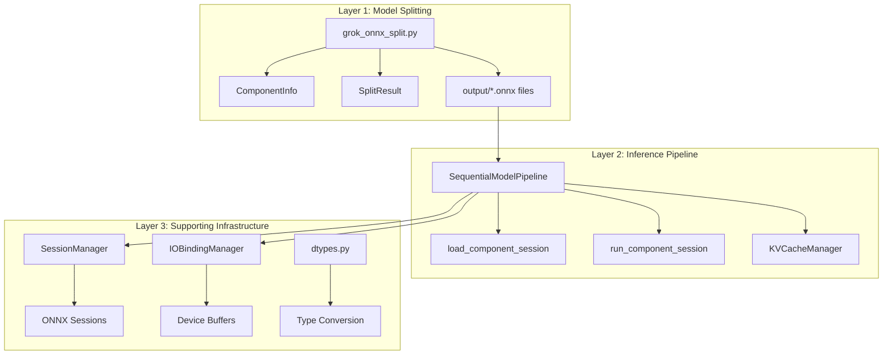

# MASTER REFERENCE: ONNX Model Chunking System

> **Senior Staff Systems Architect Analysis**  
> Comprehensive technical reference for the ONNX Model Chunking and Sequential Inference System

---

## 1. Executive Summary

This system enables running **Large Language Models (LLMs)** on memory-constrained hardware by decomposing monolithic ONNX models into semantic components and executing them sequentially. Peak memory is reduced from "entire model size" to "largest single component size" - enabling billion-parameter models on devices that could never load them whole.

---

## 2. Problem Statement

### The Challenge

| Aspect | Monolithic Model | Problem |
|--------|------------------|---------|
| Model Size | 500MB - 100GB+ | Must load entire model into RAM |
| RAM Required | 2-4× model size | Excludes consumer devices |
| Load Time | Proportional to size | Poor user experience |
| Hardware Compatibility | Requires high-end GPUs | Limits deployment targets |

**Example:**
- Qwen2.5-0.5B ONNX: ~1.0GB on disk
- Required RAM: ~2-4GB (model + activations + KV-cache)
- Target: Laptop with 8GB RAM → **Cannot run monolithically**

### The Solution

```
┌─────────────────────────────────────────────────────────────────────┐
│                          MONOLITHIC MODEL                           │
│  [Embedding + Layer_0 + Layer_1 + ... + Layer_N + Norm + LM_Head]  │
│                          Peak RAM: 3-4GB                            │
└─────────────────────────────────────────────────────────────────────┘
                                  ↓ SPLIT ↓
┌──────────┐ ┌──────────┐ ┌──────────┐     ┌──────────┐ ┌──────────┐
│Embedding │→│ Layer_0  │→│ Layer_1  │→...→│   Norm   │→│ LM_Head  │
│  ~50MB   │ │  ~30MB   │ │  ~30MB   │     │  ~1MB    │ │  ~50MB   │
└──────────┘ └──────────┘ └──────────┘     └──────────┘ └──────────┘
                     Peak RAM: ~100-200MB (sequential mode)
```

---

## 3. System Architecture

### Architecture Diagram



### Component Relationships

| Layer | Module | Responsibility |
|-------|--------|----------------|
| **Splitting** | [grok_onnx_split.py](file:///c:/Users/antmi/Downloads/onnx-model-chunking/MASTER_POC/grok_onnx_split.py) | Decompose ONNX models into semantic chunks |
| **Inference** | [grok_inference_split_model_pipeline.py](file:///c:/Users/antmi/Downloads/onnx-model-chunking/MASTER_POC/grok_inference_split_model_pipeline.py) | Orchestrate sequential execution |
| **Benchmarking** | [benchmark_onnx_split_vs_whole.py](file:///c:/Users/antmi/Downloads/onnx-model-chunking/MASTER_POC/benchmark_onnx_split_vs_whole.py) | Performance comparison |
| **Sessions** | [session_manager.py](file:///c:/Users/antmi/Downloads/onnx-model-chunking/MASTER_POC/pipeline_utils/session_manager.py) | ONNX session lifecycle |
| **I/O Binding** | [io_binding.py](file:///c:/Users/antmi/Downloads/onnx-model-chunking/MASTER_POC/pipeline_utils/io_binding.py) | Zero-copy tensor management |
| **KV Cache** | [kv_cache.py](file:///c:/Users/antmi/Downloads/onnx-model-chunking/MASTER_POC/pipeline_utils/kv_cache.py) | Autoregressive state management |

---

## 4. Core Components

### 4.1 Model Splitting Engine

**File:** [grok_onnx_split.py](file:///c:/Users/antmi/Downloads/onnx-model-chunking/MASTER_POC/grok_onnx_split.py) (1029 lines)

**Purpose:** Takes a monolithic ONNX model and decomposes it into semantic components.

**Process Flow:**

```
1. detect_architecture_from_onnx()
   └── Scan node names for patterns: /model/layers/, /transformer/h/
   └── Identify: Llama, GPT2, Qwen, Phi, etc.

2. extract_components()
   └── Create ComponentInfo for each semantic group:
       ├── embedding  → Token → Hidden state
       ├── layer_0..N → Transformer blocks  
       ├── norm       → Final normalization
       └── lm_head    → Hidden → Logits

3. compute_boundary_tensors()
   └── Calculate inputs/outputs for each component
   └── Define "interface" between components

4. create_component_onnx()
   └── Build standalone ONNX model per component
   └── Include only relevant nodes + weights
   └── Validate and save to disk
```

**Key Classes:**

```python
@dataclass
class ComponentInfo:
    component_type: str           # "embedding", "layer_0", "norm", "lm_head"
    layer_id: Optional[int]       # Layer index for transformer blocks
    node_indices: List[int]       # Indices into graph.node
    node_names: List[str]         # ONNX node names
    initializer_names: Set[str]   # Weight tensors used
    input_names: List[str]        # Input tensor names
    output_names: List[str]       # Output tensor names

@dataclass
class SplitResult:
    output_dir: str               # Directory with split files
    num_layers: int               # Number of transformer layers
    component_files: Dict[str, str]  # name → file path
    model_info: Dict[str, Any]    # Metadata
```

---

### 4.2 Inference Pipeline

**File:** [grok_inference_split_model_pipeline.py](file:///c:/Users/antmi/Downloads/onnx-model-chunking/MASTER_POC/grok_inference_split_model_pipeline.py) (638 lines)

**Purpose:** Orchestrates sequential execution of split components for text generation.

**Execution Flow (Per Token):**

```
Token IDs → [EMBEDDING] → hidden_states
                ↓
         → [LAYER_0] → hidden_states + KV_0
                ↓
         → [LAYER_1] → hidden_states + KV_1
                ↓
              ... (N layers) ...
                ↓
         → [LAYER_N] → hidden_states + KV_N
                ↓
         → [NORM] → normalized_states
                ↓
         → [LM_HEAD] → logits
                ↓
         → ARGMAX/SAMPLE → next_token_id
```

**Key Class:**

```python
class SequentialModelPipeline:
    def __init__(
        self, 
        model_path: str,              # Split components directory
        tokenizer_path: str = None,   # HuggingFace tokenizer
        providers: List[str] = None,  # ONNX execution providers
        persist_sessions: bool = False # Sequential vs Persistent mode
    )
    
    def generate(self, prompt: str, max_new_tokens: int = 20) -> str:
        """Generate text with proper prefill/decode separation."""
```

---

### 4.3 Session Manager

**File:** [session_manager.py](file:///c:/Users/antmi/Downloads/onnx-model-chunking/MASTER_POC/pipeline_utils/session_manager.py) (501 lines)

**Purpose:** Manages ONNX Runtime session lifecycle with persistence support.

**Loading Strategies:**

| Strategy | Method | Memory | Latency | Use Case |
|----------|--------|--------|---------|----------|
| **Lazy** | `get_session(name)` | Minimal | High (per-access) | CPU, memory-tight |
| **Eager** | `load_all()` | Maximum | Low (pre-paid) | NPU, GPU, production |

**Provider Priority:**

```python
PROVIDER_CATEGORIES = {
    'npu': ['VitisAIExecutionProvider', 'RyzenAIExecutionProvider'],
    'gpu': ['CUDAExecutionProvider', 'ROCmExecutionProvider', 'DmlExecutionProvider'],
    'cpu': ['CPUExecutionProvider']
}
```

---

### 4.4 I/O Binding Manager

**File:** [io_binding.py](file:///c:/Users/antmi/Downloads/onnx-model-chunking/MASTER_POC/pipeline_utils/io_binding.py) (776 lines)

**Purpose:** Zero-copy tensor management for device-resident inference.

**Memory Modes:**

```python
class MemoryMode(Enum):
    MINIMAL = "minimal"      # Load 1 component at a time, CPU copies
    PERSISTENT = "persistent" # All sessions pre-loaded, CPU copies  
    IO_BOUND = "io_bound"    # All sessions + device buffers, zero-copy
```

**Zero-Copy Flow:**

```
WITHOUT I/O Binding:          WITH I/O Binding:
Component A output            Component A output
    ↓ (Device → CPU copy)         ↓ (stays on device)
CPU numpy array               Device Buffer
    ↓ (CPU → Device copy)         ↓ (zero-copy!)
Component B input             Component B input
```

---

## 5. Execution Modes

### 5.1 Sequential Mode (Memory-Optimized)

```python
pipeline = SequentialModelPipeline(model_path, persist_sessions=False)
```

| Aspect | Value |
|--------|-------|
| Session Lifecycle | Load → Run → Unload per component |
| Peak RAM | Max(single component) + activations |
| Disk I/O | Every forward pass |
| Best For | Memory-constrained CPU inference |

### 5.2 Persistent Mode (Latency-Optimized)

```python
pipeline = SequentialModelPipeline(model_path, persist_sessions=True)
```

| Aspect | Value |
|--------|-------|
| Session Lifecycle | Load all at startup, keep resident |
| Peak RAM | Sum(all components) + activations |
| Disk I/O | Only at startup |
| Best For | GPU/NPU with sufficient memory |

### 5.3 IO_BOUND Mode (Zero-Copy)

```python
manager = IOBindingManager(device_type="cuda")
# Use with persistent sessions for maximum performance
```

| Aspect | Value |
|--------|-------|
| Session Lifecycle | Persistent + device buffer pooling |
| Peak RAM | All components + device buffers |
| Device Copies | Zero between components |
| Best For | NPU/GPU production deployment |

---

## 6. Hardware Targeting Strategy

### 6.1 CPU Strategy

```bash
python grok_inference_split_model_pipeline.py \
    --model-dir split_output/qwen2.5-0.5b \
    --providers CPUExecutionProvider \
    --prompt "Hello world"
```

- **Memory:** System RAM only
- **Best Mode:** SEQUENTIAL (minimize peak RAM) or PERSISTENT (if RAM allows)
- **Optimization:** Load/unload to minimize footprint
- **Performance:** Slowest, but runs anywhere

### 6.2 GPU Strategy

```bash
python grok_inference_split_model_pipeline.py \
    --model-dir split_output/qwen2.5-0.5b \
    --providers CUDAExecutionProvider \
    --prompt "Hello world"
```

- **Memory:** VRAM + System RAM
- **Best Mode:** PERSISTENT + IO_BOUND (zero-copy)
- **Optimization:** Keep all sessions in VRAM
- **Performance:** Fast, benefits from parallelism

### 6.3 NPU Strategy

> [!CAUTION]
> **NPU REQUIRES MONOLITHIC MODE**
> 
> NPUs (AMD Ryzen AI, Vitis AI) are NOT designed for sequential load/unload patterns.

**Why NPU is Different:**

| Aspect | GPU | NPU |
|--------|-----|-----|
| Compilation | JIT, ~10μs | AOT, ~5-50ms |
| Context Switch | ~10μs | ~5-50ms |
| Memory Model | Shared, addressable | Isolated, program-specific |
| Graph Assumption | Any subgraph OK | Entire graph required |

**NPU Decision:**
1. **Model fits in NPU memory?** → Use MONOLITHIC
2. **Model too large?** → Quantize/prune to fit, OR fall back to GPU/CPU
3. **Never** use SEQUENTIAL mode on NPU

For detailed explanation, see: [NPU Monolithic Explanation](file:///C:/Users/antmi/.gemini/antigravity/brain/8de41afe-2354-422e-ae0c-cb9b8ce7ff80/npu_monolithic_explanation.md)

---

## 7. Decision Matrix

```
START: What is your target hardware?
    │
    ├── CPU only?
    │   └── Is memory severely constrained?
    │       ├── YES → SPLIT + SEQUENTIAL mode
    │       └── NO  → MONOLITHIC or SPLIT + PERSISTENT
    │
    ├── GPU (CUDA/ROCm/DML)?
    │   └── Does model fit in VRAM?
    │       ├── YES → MONOLITHIC preferred
    │       └── NO  → SPLIT + PERSISTENT + IO_BOUND
    │
    └── NPU (AMD Ryzen AI)?
        └── Does model fit in NPU memory?
            ├── YES → MONOLITHIC (REQUIRED)
            └── NO  → Quantize, prune, or use GPU/CPU
```

| Hardware | Memory Constraint | Recommended Mode | Rationale |
|----------|-------------------|------------------|-----------|
| CPU | Tight | Split + Sequential | Minimize peak RAM |
| CPU | Relaxed | Monolithic | Maximum throughput |
| GPU | Tight | Split + Persistent + IOBound | Fit VRAM with zero-copy |
| GPU | Relaxed | Monolithic | Single CUDA graph optimization |
| NPU | Any | **Monolithic ONLY** | AOT compilation, context switch cost |

---

## 8. Project File Structure

```
onnx-model-chunking/
├── README.md                           # Project overview
├── WALKTHROUGH.md                      # Usage walkthrough
├── chunking_config.py                  # Configuration system
├── chunking_analytics.py               # Analytics/metrics
├── local_model_splitter.py             # Local model splitting utility
│
└── MASTER_POC/                         # ★ CORE IMPLEMENTATION ★
    ├── README.md                       # MASTER_POC documentation
    ├── MASTER_REFERENCE.md             # ★ THIS DOCUMENT ★
    │
    ├── grok_onnx_split.py              # Model splitter (1029 lines)
    ├── grok_inference_split_model_pipeline.py  # Inference engine (638 lines)
    ├── benchmark_onnx_split_vs_whole.py # Benchmarking (946 lines)
    │
    ├── chunking_utils/                 # Low-level utilities
    │   ├── common/
    │   │   ├── architecture.py         # Architecture detection
    │   │   ├── hf_integration.py       # HuggingFace integration
    │   │   ├── path_utils.py           # Path handling
    │   │   └── types.py                # Type definitions
    │   └── onnx/
    │       ├── splitter.py             # Core splitting logic
    │       ├── merger.py               # Component merging
    │       ├── loader.py               # Model loading
    │       └── inference.py            # Inference helpers
    │
    ├── pipeline_utils/                 # Runtime utilities
    │   ├── session_manager.py          # Session lifecycle (501 lines)
    │   ├── io_binding.py               # Zero-copy I/O (776 lines)
    │   ├── kv_cache.py                 # KV cache management
    │   ├── dtypes.py                   # Dtype handling
    │   ├── config_loader.py            # Config loading
    │   └── backend.py                  # Backend abstraction
    │
    └── output-*/                       # Cached split models
```

---

## 9. API Quick Reference

### Splitting API

```python
from grok_onnx_split import split_onnx_model, SplitResult
import argparse

params = argparse.Namespace(
    model="path/to/model.onnx",
    output="split_output/my_model",
    split_only=True
)
result: SplitResult = split_onnx_model(params)
print(f"Split into {result.num_layers} layers at {result.output_dir}")
```

### Inference API

```python
from grok_inference_split_model_pipeline import SequentialModelPipeline

# Memory-optimized mode
pipeline = SequentialModelPipeline(
    model_path="split_output/my_model",
    tokenizer_path="path/to/tokenizer",
    providers=["CPUExecutionProvider"],
    persist_sessions=False  # Sequential loading
)

# Generate text
output = pipeline.generate("What is AI?", max_new_tokens=50)
print(output)

# Cleanup
pipeline.cleanup()
```

### Session Manager API

```python
from pipeline_utils import SessionManager, SessionConfig

config = SessionConfig(
    providers=["CUDAExecutionProvider", "CPUExecutionProvider"],
    optimization_level="ALL"
)

manager = SessionManager("split_output/my_model", config)
manager.load_all()  # Eager loading for NPU/GPU

session = manager.get_session("layer_0")
# ... use session ...

manager.unload_all()
```

---

## 10. Usage Examples

### Example 1: Split a Local Model

```bash
python MASTER_POC/grok_onnx_split.py \
    --model "C:/models/qwen2.5-0.5b/model.onnx" \
    --output "split_output/qwen2.5-0.5b" \
    --split-only
```

### Example 2: Run Inference on Split Model

```bash
python MASTER_POC/grok_inference_split_model_pipeline.py \
    --model-dir "split_output/qwen2.5-0.5b" \
    --tokenizer-path "Qwen/Qwen2.5-0.5B" \
    --prompt "Explain quantum computing" \
    --tokens 50
```

### Example 3: Benchmark Split vs Monolithic

```bash
python MASTER_POC/benchmark_onnx_split_vs_whole.py \
    --whole-model "C:/models/qwen2.5-0.5b/model.onnx" \
    --split-dir "split_output/qwen2.5-0.5b" \
    --tokenizer-path "Qwen/Qwen2.5-0.5B" \
    --providers "CPUExecutionProvider" \
    --runs 3 \
    --tokens 10 \
    --output "benchmark_results.json"
```

---

## 11. Appendix: Why NPU Requires Monolithic Mode

> [!IMPORTANT]
> This section summarizes the critical reasoning. For full details, see the [detailed NPU explanation](file:///C:/Users/antmi/.gemini/antigravity/brain/8de41afe-2354-422e-ae0c-cb9b8ce7ff80/npu_monolithic_explanation.md).

**6 Critical Reasons:**

1. **Ahead-of-Time Compilation**: NPUs compile the ENTIRE graph upfront. Split models break whole-graph optimizations.

2. **Memory Movement**: Every chunk boundary forces NPU→DDR→CPU→DDR→NPU transfers. Catastrophic bandwidth overhead.

3. **Context Switch Cost**: NPU program loading: 5-50ms. GPU kernel switch: ~10μs. 500-5000× more expensive!

4. **Quantization Coherence**: NPU models need globally calibrated INT8/INT4 quantization. Split models break this.

5. **KV-Cache Isolation**: Split sessions have isolated memory. KV-cache cannot be shared without expensive transfers.

6. **Architecture Mismatch**: NPUs are fixed dataflow pipelines. GPUs are flexible kernel dispatchers.

**Bottom Line**: Running split models on NPU results in **5-100× performance regression** - defeating the purpose of NPU acceleration.

---

*Document generated: 2026-02-02 | Senior Staff Systems Architect Analysis*
